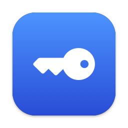
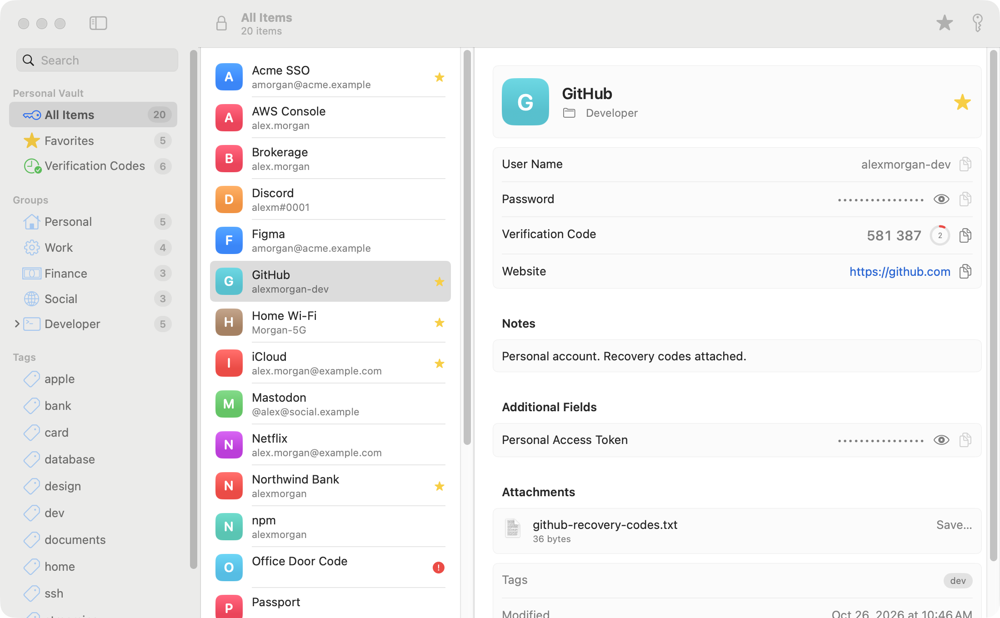
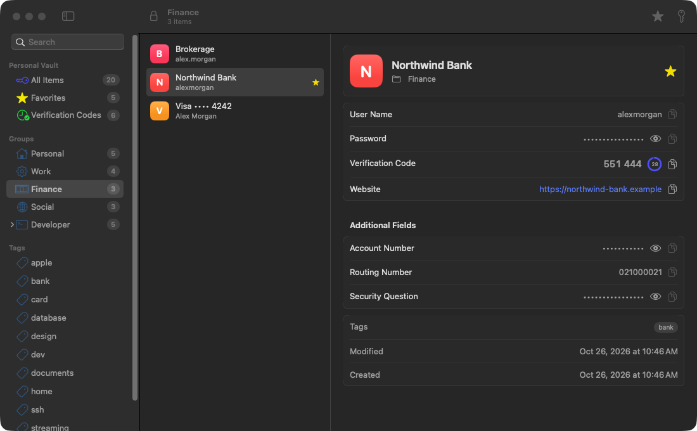
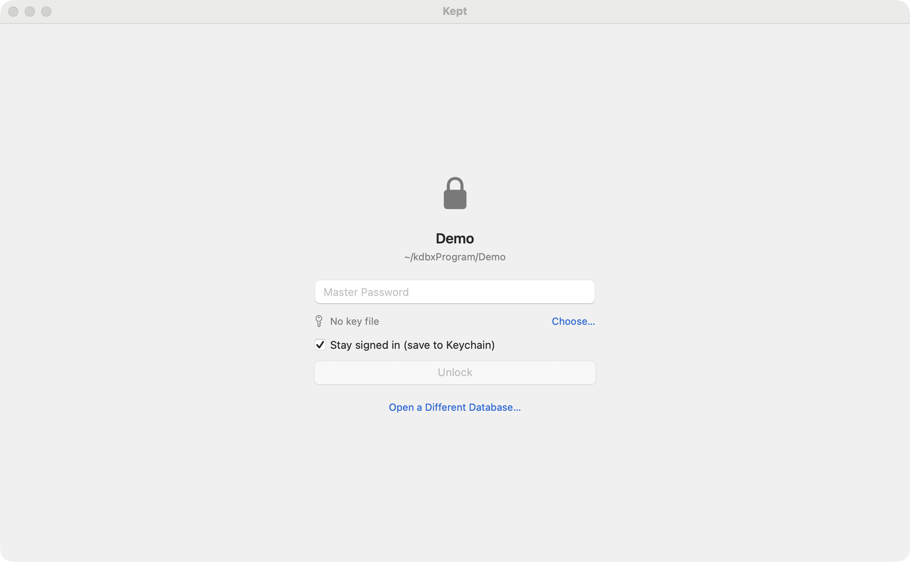
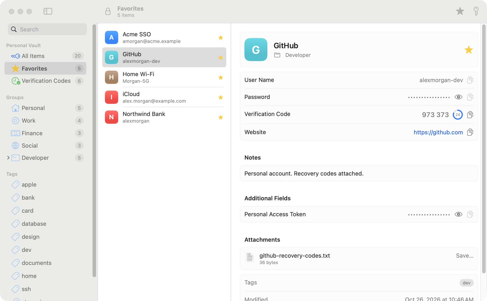

<p align="center">
  
</p>

<h1 align="center">Kept</h1>

<p align="center">
  A fast, native macOS viewer for KeePass (<code>.kdbx</code>) databases.<br>
  Built with SwiftUI. No Electron, no dependencies, no network access.
</p>

<p align="center">
  
</p>

## Why

There's no good native way to just *look at* a KeePass database on a Mac. Kept is a small app that opens your `.kdbx` file, keeps you signed in with the macOS Keychain, and gets out of your way: find an entry, copy the password, done.

Kept is **read-only**. It never writes to your database, so it's safe to point at a file that KeePass, KeePassXC or a sync service also manages.

## Features

- **Native Mac UI.** Three-column SwiftUI layout with sidebar groups, tags, search, and light and dark mode.
- **Stays signed in.** Optionally saves your master password in the macOS Keychain so it reopens unlocked. You can also require Touch ID.
- **Copy quickly.** Double-click an entry to copy its password, or use the keyboard shortcuts below. Copied secrets are marked *concealed*, so clipboard managers skip them, and they're cleared after 30 seconds by default.
- **Favorites.** Star entries to pin them in the sidebar and in the **menu bar** for one-click copy.
- **Verification codes (TOTP).** Shows live codes from KeePassXC (`otp`) and KeePass 2.47+ (`TimeOtp-*`) fields.
- **Everything else in an entry.** Custom fields (protected ones stay masked), notes, tags, attachments (Save…), expiry, and history count.
- **Live reload.** When the file changes on disk (Dropbox, iCloud, Syncthing, KeePassXC…), Kept reloads it automatically.
- **Auto-lock** (optional). Lock after an idle period, or when the screen locks or the Mac sleeps.

| Dark mode | Unlock |
| --- | --- |
|  |  |

<p align="center">
  
</p>

## Format support

| | |
| --- | --- |
| Versions | KDBX 3.1, KDBX 4.0, KDBX 4.1 |
| Ciphers | AES-256, ChaCha20 (Twofish isn't supported) |
| Key derivation | AES-KDF, Argon2d, Argon2id |
| Credentials | Password, key file (XML v1/v2, 32-byte, hex, or any file), or both |
| Protected values | Salsa20 and ChaCha20 inner streams |

All crypto is either from Apple frameworks (CommonCrypto, CryptoKit) or implemented in `Sources/KDBXKit` and tested against reference vectors (Argon2 via `argon2-cffi`, TOTP via RFC 6238).

## Install

Requires macOS 14 (Sonoma) or later and Xcode 16 / Swift 6 command-line tools.

```sh
git clone https://github.com/rbxrootx/kept.git
cd kept
Scripts/build.sh            # builds build/Kept.app
Scripts/build.sh install    # …and copies it to /Applications
```

The build is ad-hoc signed. If macOS refuses to open it the first time, right-click **Kept.app** and choose **Open**. You can also open `Package.swift` in Xcode and run the `Kept` scheme.

### Try it with the demo database

[`Demo/Demo.kdbx`](Demo/Demo.kdbx) is a fictional database (password: **`demo`**) with groups, tags, favorites, TOTP codes, custom fields and an attachment. All of the screenshots above use it.

## Keyboard shortcuts

| Action | Shortcut |
| --- | --- |
| Copy password | ⇧⌘C or double-click |
| Copy user name | ⌘B |
| Copy website | ⌘U |
| Copy verification code | ⇧⌘T |
| Open website | ⇧⌘U |
| Add to / remove from favorites | ⌘D |
| Search | ⌘F |
| Lock | ⌘L |
| Reload | ⌘R |
| Open database | ⌘O |

## Security model

Here's exactly what Kept does with your secrets:

- **Your database is never modified or sent anywhere.** Kept doesn't make network requests, doesn't fetch favicons, and has no telemetry.
- **"Stay signed in"** stores the master password (and key-file path, if any) as a generic password item in your **login keychain**, readable only while your Mac is unlocked. Turn it off on the unlock screen, or remove it under **Settings → Saved Password → Forget**.
- **"Require Touch ID"** gates the app's use of the saved password behind Touch ID or your Mac password. It's enforced by the app, not by the keychain item's access control. That's because binding keychain items to biometrics requires a signed app with entitlements, which ad-hoc builds can't have.
- **Clipboard:** sensitive copies are tagged `org.nspasteboard.ConcealedType` and `TransientType`, and they're cleared after a configurable delay, but only if you haven't copied something else since.
- **Links:** only `http(s)` URLs are ever opened. Other schemes (`file://`, `cmd://`, app URL schemes) are shown as text, so a malicious database can't launch programs.
- **Untrusted input:** the parser treats the file as hostile. Argon2 parameters, binary references, TOTP settings and timestamps are bounds-checked, and KDBX 3.1 header integrity (`<HeaderHash>`) and KDBX 4 HMACs are verified. See `testHostile*` in the tests.
- **Limitations:** decrypted values live in normal Swift `String`s while the database is unlocked and aren't zeroed on lock. The app isn't sandboxed (it needs to read databases wherever they live and watch them for changes).

Found a problem? Please open an issue, or for anything sensitive, a private security advisory.

## Project layout

```
Sources/KDBXKit/     Format + crypto library (no UI): reader, XML parser, Argon2, Salsa20/ChaCha20, TOTP
Sources/Kept/        SwiftUI app: model, keychain, clipboard, views, menu bar extra
Tests/KDBXKitTests/  Unit tests + KDBX 3.1 / 4 fixtures
Scripts/             build.sh, screenshots.sh, fixture/demo/icon generators
Demo/Demo.kdbx       Fictional sample database (password: demo)
```

Run the tests with `swift test`. Use `swift test -c release` for fast Argon2. Regenerate fixtures, the demo database and screenshots with the Python scripts in `Scripts/` (they need `pip install pykeepass`).

## License

[MIT](LICENSE)
